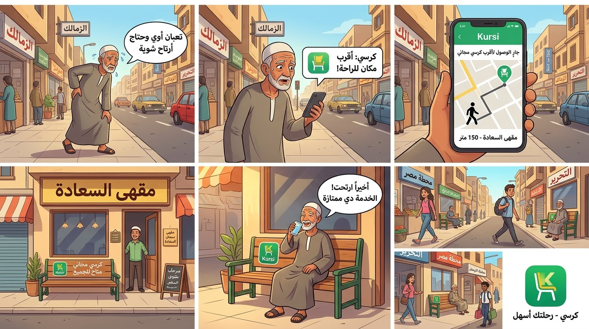

# Motion-Graphics-Designer-Capstone-Project

Create a 30-second promotional animated video for a fictional product or service, incorporating essential features from Adobe Illustrator, Adobe After Effects, Adobe Premiere Pro, Adobe Audition, and Adobe Character Animator. Include a brief project description outlining the concept, key design elements, and animation techniques used.

---

## 📌 Project Idea: "Kursi" (كرسي)
**"Kursi"** is a community-driven mobile application concept designed to solve a common urban challenge: pedestrian fatigue. The app connects walkers looking for a place to rest with local businesses, shops, and partner venues that offer free outdoor seating ("Kursi"). 

* **Objective:** Create a polished 30-second promotional motion graphics video highlighting social responsibility and urban comfort.
* **Key Storyboard Flow:** 
  1. A tired pedestrian struggling in a bustling Cairo street (Zamalek).
  2. A push notification triggers the **Kursi** app on their smartphone.
  3. GPS routing guides the user to the nearest free resting spot at a local venue ("مقهى السعادة").
  4. The user sits down comfortably, showcasing the wider initiative across different city locations.

---

### 🎨 Storyboard Visual Flow


---

## 🎙️ Voiceover Script & Timing (Adobe Audition)

| Scene | Time | Voiceover Script | Visual / After Effects Action |
| :--- | :--- | :--- | :--- |
| **Scene 1** | 00:00 - 00:07 | "يوم طويل.. مشي كتير.. وفي نص المشوار بتحس بالتعب وعاوز بس دقيقة ترتاح فيها.." | Wide shot of a crowded street, an elderly person walking slowly looking exhausted, with a thought bubble indicating fatigue[cite: 6]. |
| **Scene 2** | 00:07 - 00:14 | "بس تلاقي فين مكان مجاني تقعد تحس فيه براحتك؟ الحل في تطبيق 'كرسي'!" | Smartphone appears with a slight vibration and a push notification showing the nearest resting place[cite: 6]. |
| **Scene 3** | 00:14 - 00:21 | "بضغطة زرار، بيدلك على أقرب كرسي مجاني في طريقك، مقدم من أصحاب المتاجر والمصالح لدعم المارة." | GPS map interface on the mobile showing walking directions to "مقهى السعادة" (150 meters away)[cite: 6]. |
| **Scene 4** | 00:21 - 00:30 | "امشي براحتك.. ومتشيلش هم التعب. مع كرسي.. رحلتك أسهل." | The person sits comfortably on the free chair drinking water, followed by a general view of several streets (Tahrir, Ramses Station) with the final app logo[cite: 6]. |

---

## 👥 Team Members
1. Ahmed Moharram Tawfik
2. Sabah Ramadan Ahmed
3. Nada Nasr Mohamed
4. Lamiaa Medhat Elhosseny

---

## 📅 Work Plan
* **Phase 1: Concept & Storyboarding (Days 1–2)**
  * Brainstorming the "Kursi" app concept and drafting the 6-panel storyboard.
  * Allocating team responsibilities and setting timeline milestones.
* **Phase 2: Asset Design & Illustration (Days 3–4)**
  * Designing vector assets, character rigs, and UI mockups using **Adobe Illustrator**.
  * Organizing clean layer structures for smooth animation.
* **Phase 3: Animation & Motion Graphics (Days 5–7)**
  * Importing vector compositions into **Adobe After Effects**.
  * Animating character movements, map routing paths, and UI notification transitions.
* **Phase 4: Audio Engineering & Final Editing (Days 8–9)**
  * Recording, cleaning, and mastering the voiceover and background track in **Adobe Audition**.
  * Assembling the final sequence, applying timeline cuts, and mixing audio in **Adobe Premiere Pro**.
  * Final review, quality check, and repository export.

---

## ⚙️ Roles & Responsibilities
* **Ahmed Moharram Tawfik:** Creative Direction, Concept Design, and Storyboard Development (Overseeing the overall vision, scriptwriting, and vector asset planning).
* **Sabah Ramadan Ahmed:** Asset Design & Illustration (Creating vector graphics, character rigs, and UI elements in Adobe Illustrator).
* **Nada Nasr Mohamed:** Motion Graphics & Animation (Handling After Effects compositions, character movements, and map/GPS UI animations).
* **Lamiaa Medhat Elhosseny:** Audio Engineering & Post-Production (Managing voiceover recording, audio mixing in Adobe Audition, timeline assembly, and final export in Adobe Premiere Pro).

---

## 📈 KPIs (Key Performance Indicators)
* **Adherence to Duration:** Successfully delivering the promotional video strictly within the 30-second timeframe limit.
* **Toolchain Integration:** Successful utilization of all mandated Adobe software packages (Illustrator, After Effects, Premiere Pro, Audition).
* **Visual & Narrative Clarity:** Clear demonstration of the problem-solution workflow through the storyboard and smooth motion transitions.
* **Collaboration & Documentation:** Effective version control and clean repository structure via GitHub.

---

## 👨‍🏫 Instructor
* **Mr. Galal Badr**

---

## 📂 Project Files
```text
├── assets/                  # Illustrator (.ai) vector files and exported layers
├── storyboard/              # Storyboard sketches and visual sequence boards
├── audio/                   # Voiceover recordings and background music tracks
├── video/                   # After Effects project files and final Premiere Pro export (.mp4)
└── README.md                # Project documentation
